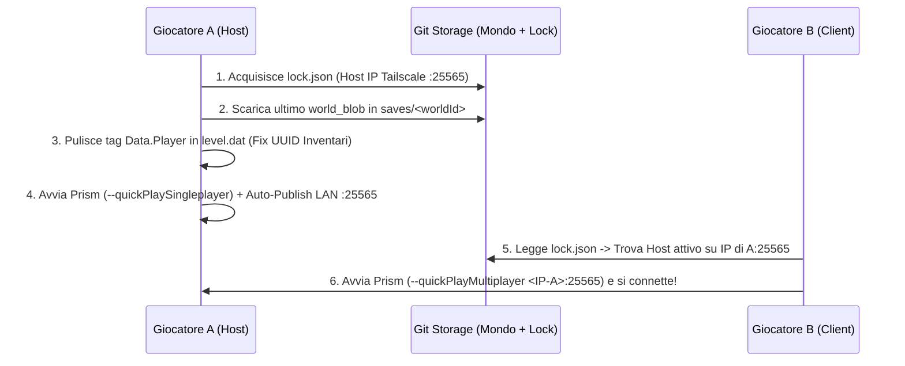

# Specifica Architetturale & Report Completo: Cambio di Paradigma `mcServer4all` (v2.1 / v3.0)

* **Data**: 08 Novembre 2026
* **Riferimenti Bug**: [BUG_REPORT_CONFIG_DESYNC.md](file:///C:/Users/psava/Desktop/Game/mc4/mc4%202.0/mcServer4all/bugIssue/BUG_REPORT_CONFIG_DESYNC.md), [BUG_SPEC_GIT_SYNC_STALL.md](file:///C:/Users/psava/Desktop/Game/mc4/mc4%202.0/mcServer4all/bugIssue/BUG_SPEC_GIT_SYNC_STALL.md)
* **Caso di Studio Reale**: Modpack *FTB Skies 2 Aero v1.15.0* (Minecraft 1.21.1, NeoForge 21.1.265, 481 mod)
* **Obiettivo**: Risolvere strutturalmente i colli di bottiglia prestazionali, di rete, di sincronizzazione e di usabilità tramite un cambio radicale di paradigma su **Storage Modpack (Bundle + Link CDN)**, **Esecuzione Runtime (Single-JVM Client-as-Host)** e **Semplicità GUI/Configurazione (Zero Residui Legacy v1.0)**.

---

## 1. Executive Summary: Perché il Paradigma Attuale Fallisce sui Modpack Moderni

L'ispezione del bytecode di [`mcServer4all.jar`](file:///C:/Users/psava/Desktop/Game/mc4/mc4%202.0/mcServer4all/mcServer4all.jar) e del repository di stato generato per il mondo `skies2` ha evidenziato che i problemi riscontrati non sono semplici difetti isolati, ma conseguenze dirette di **quattro scelte architetturali** dell'attuale versione v2.0:

1. **Atomizzazione dei file su Git (`modfiles/<sha256>`)**:
   Invece di trattare le configurazioni del modpack (`overrides/`) come un pacchetto unitario compresso, `LockBuilder` esplode ogni singolo file di `config/`, `kubejs/`, `datapacks/` e `defaultconfigs/` in blob individuali non compressi dentro Git, arrivando a caricare **9.981 file sfusi (358,34 MB)** per un singolo mondo.
2. **Ricostruzione Selettiva Asimmetrica (`pinnedConfigs` vs `serverFiles`)**:
   Il Server riceve tutti i 9.810 file di configurazione/override, mentre il Client Prism riceve solo i file che soddisfano 4 pattern glob restrittivi (`config/**/*-common.toml`, `kubejs/**`, `config/paxi/**`, `config/openloader/**`), pari a soli **685 file** nella cartella `config/`. Nei modpack Minecraft 1.20+/1.21+ dove i registri di blocchi e oggetti sono definiti via JSON in sottocartelle di `config/` (es. *Mystical Customization*, *NeoVitae*), il Client non registra gli stessi oggetti del Server e viene disconnesso durante l'handshake di rete (`unknown keys`).
3. **Doppia Istanza JVM sull'Host (Server Dedicato + Client)**:
   Avviare un processo Server Dedicato NeoForge separato dal processo Client Minecraft sulla stessa macchina costringe il PC dell'Host a caricare **due volte in RAM** 481 mod, tutti i registri di gioco e i motori di scripting, portando il consumo di memoria a **14–16 GB di sola JVM**.
4. **Ibrido Confuso v1.0 / v2.0 nella GUI e nel Codice**:
   L'applicazione mantiene ancora pannelli, impostazioni e classi della vecchia v1.0 (monomondo manuale, `DashboardPanel`, `Whitelist` con nomi finti `player_alpha`/`player_beta`, percorsi manuali server/client) sovrapposti al sistema multi-mondo v2.0 (`WorldsPanel`), generando conflitti di configurazione e confusione operativa.

---

## 2. Il Cambio di Paradigma: Architettura a Confronto

Il nuovo modello abbandona l'approccio *"file-by-file granulare + doppia JVM + GUI multi-tab dispersiva"* in favore di **tre pilastri**:
- **Pilastro 1 — Distribuzione "Pack-Native" (Link Manifest + Archivio `overrides` Compresso)**.
- **Pilastro 2 — Runtime "Client-as-Server" (Single-JVM Integrated Host su Tailscale + Fast Handover)**.
- **Pilastro 3 — GUI Unificata "Mondi" & Configurazione Zero-Friction (Rimozione Dashboard, Monitor Server e Whitelist)**.

```mermaid
flowchart TD
    subgraph OGGI["Paradigma Attuale (v2.0) — Critico"]
        A1["ZIP CurseForge (manifest.json + overrides/)"] --> A2["LockBuilder esplode 9.810 file + 173 JAR"]
        A2 --> A3["Git Storage: 9.981 file sfusi in modfiles/"]
        A3 --> A4["Importazione Amico: 2.600x git ls-remote (1.8 ore)"]
        A3 --> A5["Server: 2.001 config | Client: 685 config (DESYNC!)"]
        A5 --> A6["Host avvia 2 JVM: Server (7 GB) + Client (8 GB) = 15 GB RAM"]
    end

    subgraph NUOVO["Nuovo Paradigma (v2.1 / v3.0) — Ottimizzato"]
        B1["ZIP CurseForge / .mrpack"] --> B2["Estrazione Manifest (25 KB) + Compressione overrides.tar.zst"]
        B2 --> B3["Git Storage: Solo 2-3 file (manifest + overrides bundle)"]
        B3 --> B4["Importazione Amico: 1 git fetch + Download CDN Parallelo (2 min)"]
        B4 --> B5["Estrazione 1:1 di overrides su istanza Prism (ZERO DESYNC)"]
        B5 --> B6["Host avvia 1 sola JVM: Client con IntegratedServer (:25565) = 7.5 GB RAM"]
    end
```

---

## 3. Pilastro 1: Nuovo Paradigma di Sincronizzazione Modpack su Git

### 3.1. Come funziona oggi (Analisi Dati Reali su `skies2`)
Analizzando il file `ftb-skies-2-aero-1.15.0.zip` originale rispetto a quanto caricato da `mcServer4all` in `worlds/skies2/`:
- Lo `.zip` CurseForge originale contiene **`manifest.json` (25 KB)** con i riferimenti (`projectID` + `fileID`) a tutte le **481 mod**, più la cartella **`overrides/`** (config, kubejs, datapacks, defaultconfigs).
- `mcServer4all` oggi scompone `overrides/` in **9.810 file singoli** e, quando non usa il manifest CurseForge, interroga solo Modrinth (`SourceResolver$Modrinth`), caricando su Git anche **173 file `.jar`** non trovati su Modrinth.
- Durante l'importazione dell'invito, `GitStorage.exists()` e `GitStorage.localFile()` invocano `syncFromRemote()` (`git ls-remote`) per ogni singolo file prima ancora di controllare la presenza sul disco locale.

### 3.2. La Nuova Struttura su Git (`worlds/<worldId>/`)
Invece di 9.981 file in `modfiles/<sha256>`, il repository Git conterrà esclusivamente:

1. **`world.json`** (~1 KB): Metadati essenziali del mondo (versione MC, NeoForge/Forge/Fabric, RAM consigliata, senza whitelist).
2. **`mods.lock.json`** (~60 KB):
   - Lista delle mod con i rispettivi link diretti **CurseForge** (`projectID:fileID` / URL CDN) e **Modrinth**, più l'hash SHA-256 per la verifica di integrità.
   - Se l'utente crea il mondo da una cartella già installata anziché da uno `.zip`, un nuovo **`CurseForgeFingerprintResolver`** calcola l'hash *Murmur2* dei `.jar` e interroga in un'unica chiamata batch `POST https://api.curseforge.com/v1/fingerprints` per ottenere tutti i link CDN ufficiali senza caricare i `.jar` su Git.
3. **`overrides.tar.zst` (eventualmente suddiviso in parti `< 75 MB`: `overrides.part01.tar.zst`, `overrides.part02.tar.zst`)**:
   - Un unico archivio compresso Zstd contenente **integralmente** le cartelle `overrides/` del modpack (`config/`, `defaultconfigs/`, `kubejs/`, `datapacks/`, `scripts/`, ed eventuali mod custom non presenti sui CDN).
   - Lo splitting automatico a 75 MB garantisce il rispetto assoluto del limite hard di GitHub (**100 MB per singolo file**).

> [!IMPORTANT]
> **Impatto immediato**: Quando un amico importa `<mondo>.mcsync`, `mcServer4all` esegue **un singolo `git fetch`**, estrae `overrides.tar.zst` direttamente nella cartella dell'istanza e scarica i `.jar` delle mod dai CDN di CurseForge/Modrinth con 8 thread in parallelo. Il tempo di importazione scende da **~110 minuti a ~2 minuti**, ed è **impossibile** avere differenze di configurazione tra i giocatori.

---

## 4. Pilastro 2: Il Client come Server ("Single-JVM Integrated Host")

### 4.1. Architettura a Singola Istanza
Quando un giocatore avvia un mondo in **Giocatore Singolo**, il Client di Minecraft avvia già al suo interno un server completo (**`IntegratedServer`**) che condivide la stessa JVM, le stesse classi caricate e gli stessi registri NeoForge/Fabric del Client.
Poiché tutti i partecipanti sono connessi tramite **Tailscale** (una LAN virtuale livello 3), basta esporre l'`IntegratedServer` dell'Host sulla porta fissa **`25565`** affinché tutti gli altri giocatori entrino come normali Client multiplayer su `<IP-Tailscale-Host>:25565`.

### 4.2. Come vengono automatizzati gli step tecnici
1. **Ingresso diretto senza cliccare nei menu**:
   `mcServer4all` avvia Prism Launcher passando gli argomenti standard di Minecraft (supportati nativamente da MC 1.20+):
   - Per l'**Host**: `--quickPlaySingleplayer "<worldId>"` (il client si avvia ed entra da solo nel mondo).
   - Per i **Client**: `--quickPlayMultiplayer "<hostTailscaleIp>:25565"` (il client si avvia e si connette da solo all'Host).
2. **Apertura automatica della porta `25565`**:
   Viene iniettata automaticamente nell'istanza una micro-mod helper (o script KubeJS / *Lan Server Properties*) che, all'evento `ServerStartedEvent` dell'`IntegratedServer`, invoca `publishServer(GameType, allowCheats, 25565)` e imposta `pauseOnLostFocus: false` in `options.txt`.
3. **Eliminazione della cartella duplicata `servers/<worldId>/`**:
   Non serve più mantenere una seconda installazione di NeoForge Server su disco: tutto vive dentro l'istanza Prism `.tools/PrismLauncher/instances/mcsync-<worldId>/minecraft/`.

---

## 5. Pilastro 3: Redesign Completo della GUI & Pulizia Configurazione

L'ispezione delle classi `MainFrame`, `DashboardPanel`, `WorldsPanel`, `ServerMonitorPanel` e `ConfigEditorPanel` ha rivelato forti ridondanze derivanti dalla vecchia architettura v1.0.

### 5.1. Eliminazione di `DashboardPanel` e `ServerMonitorPanel` $\rightarrow$ Vista Unica `Mondi`
Attualmente la finestra presenta 5 tab (`Dashboard`, `Mondi`, `Monitor Server`, `Configurazione`, `Diagnostica`):
- **`DashboardPanel` è obsoleto**: mostra pulsanti della v1.0 (`Sincronizza Mod`, `Push Mod`, `Importa ZIP`, `Installa Server`) che lavoravano su un singolo server manuale e che oggi collidono con la gestione multi-mondo di `WorldsPanel`.
- **`ServerMonitorPanel` non è più necessario**: con il paradigma *Client-as-Server* non esiste più un processo server dedicato separato da controllare via stdout/stdin.
- **Nuovo Layout GUI Snello (2 soli Tab principali: `Mondi` e `Impostazioni`, più `Diagnostica` integrata)**:
  1. **Header Bar compatta sempre visibile**: mostra i semafori di stato essenziali (**Tailscale IP rilevato**, **Stato Storage Git**, **Nome Giocatore**).
  2. **Tab Principale `Mondi` (Tutto in un'unica schermata)**:
     - Tabella chiara dei mondi con stato live (*"Libero — Gioca come Host"* oppure *"In corso — Ospitato da `<player>`"*).
     - Pulsante primario grande **`GIOCA`** + toolbar pulita (`Crea Mondo`, `Importa Invito .mcsync`, `Esporta Invito`, `Aggiorna Modpack`, `Sblocca Lock`).
     - **Barra di Progresso Reale (`JProgressBar`) + Pannello Log espandibile in basso**: mostra finalmente l'avanzamento reale con percentuale e contatore (`Download mod [142/481] - 29%`, `Estrazione overrides...`, `Upload mondo su Git...`), eliminando l'effetto "finestra congelata".

### 5.2. Rimozione Totale della Whitelist (Inutile e Dannosa)
- **Perché è inutile**: la rete P2P **Tailscale** e il file d'invito privato `.mcsync` costituiscono già un perimetro di sicurezza chiuso tra amici.
- **Perché oggi è dannosa**: in `config.example.json` erano presenti i valori segnaposto `["player_alpha", "player_beta"]`. Durante la creazione di `skies2`, `WorldService.create()` ha copiato automaticamente `["player_alpha", "player_beta"]` dentro `worlds/skies2/world.json`. Se la whitelist viene applicata dal server, **nessun giocatore reale può entrare**!
- **Intervento**: rimozione completa di `whitelistPlayers` da `ConfigEditorPanel`, `Config.java` e `WorldRecipe.java`, forzando sempre `white-list=false`.

### 5.3. Semplificazione Radicale del Tab `Impostazioni` (`ConfigEditorPanel`)
Vengono rimossi tutti i campi legacy della v1.0 che confondono l'utente e vengono sovrascritti dal sistema multi-mondo:
- ❌ **Campi rimossi**: `Cartella Server` (`txtServerDir`), `Preset Comando Server` (`cmbStartPreset`), `Comando Avvio Server` (`txtServerCmd`), `Istanza Prism` (`cmbPrismInstance`), `Cartella Istanza Client` (`txtClientInstanceDir`), `Client Sync Scope` (`MODS_ONLY` / `MODS_AND_CONFIG`), `Lista Whitelist`, `Checkbox Accetta EULA` (l'accettazione EULA diventa sempre automatica).
- ✅ **Campi mantenuti (solo 4 impostazioni chiare)**:
  1. **Nickname Giocatore (`playerId`)**.
  2. **RAM allocata a Minecraft** (unico slider chiaro Min/Max, es. `6 GB – 8 GB`).
  3. **Credenziali Storage Git** (`gitRemoteUrl`, `gitToken`, con pulsante *Test Connessione* — auto-compilati quando si importa un invito `.mcsync`).
  4. **CurseForge API Key** (anch'essa auto-compilata dall'invito `.mcsync`).

---

## 6. Altri 5 Bug e Problemi Architetturali Scoperti nel Bytecode

Oltre ai due bug segnalati nei report iniziali, l'analisi completa del bytecode di `mcServer4all.jar` ha portato alla luce altri **5 problemi strutturali** che verranno risolti contestualmente:

### 6.1. Il file d'invito `.mcsync` (`Invite.java`) non include la `curseforgeApiKey`
- **Problema**: `Invite.class` serializza il token Git (`storage.token`), ma **non** la `curseforgeApiKey`. Quando un amico installa `mcServer4all` da zero e importa `skies2.mcsync`, il suo `config.json` rimane con `curseforgeApiKey: ""`. Qualsiasi risoluzione di URL CurseForge lato client fallisce a meno che l'amico non si registri manualmente sul portale sviluppatori di CurseForge.
- **Soluzione**: Includere `curseforgeApiKey` nel record `Invite` e copiarla automaticamente in `config.json` durante `importInvite()`, garantendo un'esperienza realmente *zero-config* per chi riceve l'invito.

### 6.2. `PackReader.readCurseForge()` esegue 481 chiamate HTTP e 481 download su UN SOLO thread
- **Problema**: Durante **"Crea Mondo"** da uno `.zip` CurseForge, `PackReader.readCurseForge()` (linee bytecode 606–721) itera in modo **sequenziale single-thread** su `manifest.json`:
  1. Esegue **481 chiamate HTTP GET separate** una dopo l'altra (`/v1/mods/{projectID}/files/{fileID}`).
  2. Scarica tutti i **481 file `.jar` uno alla volta su un singolo thread** in una directory temporanea `cfpack-xxx/mods/`, ne calcola gli hash e poi li ricopia nuovamente nella cache `.mcsync/cache/modfiles/`.
- **Soluzione**:
  1. Usare l'endpoint batch ufficiale di CurseForge (`POST /v1/mods/files` inviando tutti i 481 `fileID` in un'unica richiesta JSON, che risponde in **~300 ms** invece di 481 richieste sequenziali).
  2. Scaricare i `.jar` direttamente nella `ModCache` usando il pool parallelo a 8 thread.

### 6.3. Clonazione moltiplicata dell'intero repository Git per ogni mondo (`git-store` duplicato)
- **Problema**: `GitStorage` inizializza il repository locale in `config.stateDir().resolve("git-store")`, che per ciascun mondo punta a `servers/<worldId>/.mcsync/git-store`. Poiché tutti i mondi condividono lo stesso branch `mcsync-state` (distinti solo dal prefisso `worlds/<worldId>/`), avere 3 mondi comporta **clonare 3 volte l'intero repository Git con i dati di tutti i mondi** in 3 cartelle diverse.
- **Soluzione**: Centralizzare `git-store` in un'unica directory condivisa `.mcsync/git-store` nella root di `mcServer4all`.

### 6.4. `WorldStore.update()` non usa il commit batch su backend Git
- **Problema**: Mentre `WorldStore.publishNew()` usa `stageBlobs()` (che invoca `commitSessionDeltaBatch` facendo un unico commit/push), il metodo `WorldStore.update()` (usato per aggiornare un modpack esistente) esegue un ciclo `for` chiamando `storage.uploadFile()` per ogni nuovo file, scatenando un `git commit` + `git push` separato per ciascun file aggiunto.
- **Soluzione**: Unificare anche `WorldStore.update()` sull'operazione batch atomica.

### 6.5. Coesistenza di codice Legacy v1.0 (`ModsSyncManager`) e v2.0 (`LockedModsSync`)
- **Problema**: Nel `.jar` coesistono ancora le classi della v1.0 (`ModsSyncManager`, `ModsManifest`, `ServerProfileDetector`) insieme a quelle della v2.0 (`world.*`). In `MainOrchestrator`, se `mods.lock.json` non viene trovato, il programma cade silenziosamente nel vecchio `ModsSyncManager` v1.0.
- **Soluzione**: Rimuovere definitivamente il ramo legacy v1.0, mantenendo un unico flusso deterministico basato sul nuovo paradigma.

---

## 7. Vantaggi Misurabili della Nuova Soluzione

| Area | Paradigma Attuale (v2.0) | Nuovo Paradigma (v2.1 / v3.0) | Beneficio Netto |
| :--- | :--- | :--- | :--- |
| **Memoria RAM sull'Host** | **14 – 16 GB** (Server JVM + Client JVM) | **7 – 8 GB** (Singola JVM Client+Server) | **Risparmio del 50% di RAM** |
| **Carico CPU in Avvio** | Compilazione/caricamento doppio di 481 mod | Caricamento singolo | **Avvio Host 2x più rapido** |
| **File nel Repo Git** | **9.981 file** sfusi in `modfiles/` | **2 – 3 file** (`mods.lock.json` + `overrides.tar.zst`) | **-99,9% di file su Git** |
| **Tempo Creazione Mondo** | **25 – 40 minuti** (481 GET + download single-thread) | **2 – 3 minuti** (1 POST batch + download 8-thread) | **~12 volte più veloce** |
| **Tempo Importazione Invito** | **90 – 120 minuti** (2.600+ chiamate `git ls-remote`) | **1 – 3 minuti** (1 `git fetch` + download CDN) | **~50 volte più veloce** |
| **Allineamento Registri Mod** | Parziale (685 file su Client vs 2.001 su Server) | **Totale (100% identico da `overrides.tar.zst`)** | **Zero errori `unknown keys`** |
| **Complessità GUI / Config** | 5 Tab, 15+ opzioni manuali, Whitelist buggata | **2 Tab (`Mondi`, `Impostazioni`), 4 campi, Zero-Config Invito** | **UX immediata e a prova di errore** |

---

## 8. Problemi Potenziali del Nuovo Paradigma e Soluzioni Tecniche Previste

Di seguito sono elencati tutti i rischi tecnici dell'approccio *Single-JVM / Bundle* e le relative contromisure architetturali:

### Problema 1: Il Bug dell'Inventario Singleplayer (`level.dat -> Data.Player`)
* **Il rischio**: Nei mondi aperti in Singleplayer/LAN, Minecraft salva i dati dell'utente che ospita la partita sia in `playerdata/<UUID>.dat` sia dentro il tag speciale `Data.Player` del file `level.dat`. Quando un secondo giocatore scarica il mondo e lo apre in Singleplayer per fare da nuovo Host, Minecraft dà priorità al tag `Data.Player` dentro `level.dat`: il nuovo Host si risveglierebbe nella posizione e con l'inventario del vecchio Host!
* **La soluzione definitiva**: `mcServer4all` (in Java, tramite manipolazione NBT sul file `level.dat` compresso GZip) **rimuove automaticamente la chiave `Data.Player` da `level.dat`** subito prima dell'upload a fine sessione (e/o subito dopo il download prima dell'avvio). In assenza di `Data.Player`, Minecraft carica per chiunque — incluso l'Host — esclusivamente il file `playerdata/<UUID>.dat` corrispondente al proprio account!

### Problema 2: Migrazione dell'Host quando chi ospita deve staccare ("Host Handover")
* **Il rischio**: Con il Server Dedicato, l'Host poteva chiudere il proprio gioco lasciando aperto il terminale del server. Con il Client-as-Server, se l'Host chiude Minecraft, il server si ferma per tutti.
* **Perché il cambio "Zero-Disconnect" istantaneo non esiste in Minecraft**: I chunk modificati (`region/*.mca`) e lo stato delle TileEntity (macchinari, cavi) vivono nella RAM dell'Host e vengono consolidati su disco solo al salvataggio del mondo; inoltre il nuovo Host deve passare dalla modalità rete client all'avvio del proprio thread `IntegratedServer`.
* **La soluzione ("Fast Handover" in 15 secondi senza riavviare Minecraft)**:
  Poiché il riavvio del modpack da zero impiega 4–5 minuti, il segreto è **non chiudere mai il client Minecraft** del giocatore che subentra come Host:
  1. **Host A** esce dal mondo tornando al Menu Principale (salvataggio su disco in 2 secondi).
  2. `mcServer4all` su **Host A** rileva la chiusura del mondo, carica il delta Zstd dei file modificati (pochi MB) e rilascia `lock.json` (**5–8 secondi**).
  3. **Giocatore B** (che si trova già sul Menu Principale di Minecraft con le 481 mod già caricate in RAM!) clicca **"Diventa Host"** su `mcServer4all` (o `mcServer4all` scarica automaticamente il delta nella sua cartella `saves/<worldId>` appena vede il rilascio del lock).
  4. **Giocatore B** entra nel mondo da *Giocatore Singolo* (che apre in automatico la porta `25565`): in **10–15 secondi totali** la sessione riprende dal punto esatto in cui era stata interrotta, senza mai aver riavviato il gioco.
  *(Nota: la modalità "Server Dedicato Headless" `--no-client` può comunque restare disponibile da CLI per chi desidera lasciare un PC acceso 24/7 senza giocare).*

### Problema 3: Limite di 100 MB per file su GitHub per `overrides` molto grandi
* **Il rischio**: In modpack come *FTB Skies 2*, la cartella `overrides/` contiene 150 MB di immagini PNG non comprimibili (sfondi menu *FancyMenu* e texture *KubeJS*), superando i 100 MB se impacchettata in un singolo file.
* **La soluzione**: Il compressore di `overrides` utilizza volumi multi-parte automatici con soglia a **75 MB** (`overrides.part01.tar.zst`, `overrides.part02.tar.zst`). Rimangono solo 2–3 file su Git, tutti ampiamente sotto il limite di 100 MB di GitHub.

### Problema 4: Mod con Download Disabilitato per Terze Parti su CurseForge
* **Il rischio**: Alcuni autori di mod su CurseForge disabilitano il download automatico via API per i launcher di terze parti (`downloadUrl == null` nella risposta API di CurseForge).
* **La soluzione a 3 livelli**:
  1. Se `downloadUrl` di CurseForge è `null`, `mcServer4all` cerca automaticamente lo stesso file (tramite hash SHA-1) su **Modrinth** e sul CDN secondario di fallback (`edge.forgecdn.net`).
  2. Solo per le pochissime mod (tipicamente 0–5 su un intero modpack) che non fossero scaricabili da alcun CDN pubblico, chi crea il mondo le include automaticamente dentro un piccolo bundle `custom_mods.tar.zst` su Git, così chi importa l'invito non deve mai scaricare nulla a mano dal browser.

### Problema 5: Sovrascrittura delle Impostazioni Personali del Giocatore (Tasti / Grafica)
* **Il rischio**: Estraendo l'intero `overrides.tar.zst` sul Client ad ogni avvio, si rischierebbe di sovrascrivere i controlli personalizzati o le impostazioni grafiche dell'utente.
* **La soluzione**:
  - I file critici per i registri e il gameplay (`config/**`, `defaultconfigs/**`, `kubejs/**`, `datapacks/**`) vengono sempre mantenuti allineati al 100% con il modpack.
  - I file di preferenze personali (`options.txt`, `optionsof.txt`, `config/*-client.toml`) vengono estratti in modalità **Seed-Only**: vengono creati al primo setup dell'istanza (così il giocatore parte con la grafica preconfigurata dal modpack), ma **non vengono sovrascritti** se esistono già sul PC del giocatore.

---

## 9. Piano di Implementazione Tecnica (Moduli da Modificare)

1. **`GitStorage.java`**:
   - Centralizzare `git-store` in `.mcsync/git-store` (non più duplicato dentro `servers/<worldId>/`).
   - Aggiungere **Fast-Path locale** in `exists()` e `localFile()` + **Debounce / TTL (30s)** su `syncFromRemote()`.
2. **`PackReader.java`, `LockBuilder.java` & `Invite.java`**:
   - Sostituire le 481 chiamate GET sequenziali a CurseForge con una singola chiamata batch `POST /v1/mods/files` + lookup fingerprint *Murmur2*.
   - Impacchettare l'intera directory `overrides/` in `overrides.partXX.tar.zst` (max 75 MB per parte) invece di generare migliaia di entry in `pinnedConfigs` e `serverFiles`.
   - Includere `curseforgeApiKey` dentro `Invite.java` (`.mcsync`) per rendere l'importazione invito 100% *zero-config*.
3. **`LockMaterializer.java` & `ModDownloader.java`**:
   - Sostituire il loop sui micro-blob di config con l'estrazione diretta di `overrides.partXX.tar.zst` (con politica *Seed-Only* per `*-client.toml` e `options.txt`).
   - Esporre callback di progresso `[X/N]` verso la `JProgressBar` della GUI.
4. **Modalità Single-JVM Client-Host (`ClientLauncher`, `LevelDatCleaner`)**:
   - Implementare la pulizia automatica del tag NBT `Data.Player` da `level.dat` prima/dopo la sincronizzazione del salvataggio.
   - Avviare l'istanza Prism direttamente nel mondo (`--quickPlaySingleplayer` + auto-publish LAN su porta `25565` per l'Host; `--quickPlayMultiplayer <hostIp>:25565` per i Client).
5. **Restyling GUI (`MainFrame`, `WorldsPanel`, `ConfigEditorPanel`)**:
   - Rimuovere `DashboardPanel`, `ServerMonitorPanel` e tutta la gestione `Whitelist`.
   - Unificare la schermata principale in `Mondi` con indicatori di stato in alto, pulsanti azione rapidi e barra di progresso + log integrati in basso.
   - Ridurre `ConfigEditorPanel` ai 4 parametri essenziali (Player ID, RAM, Git Storage, CurseForge API Key).
